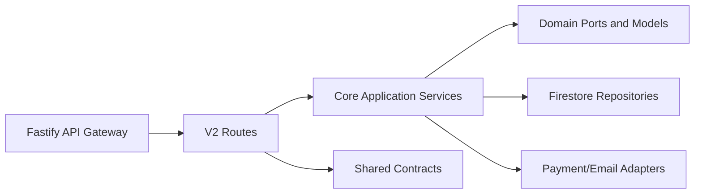
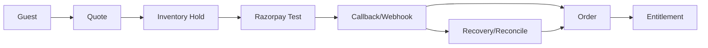
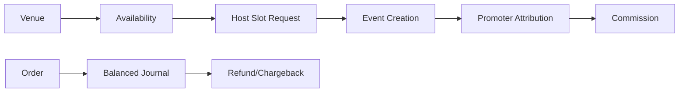
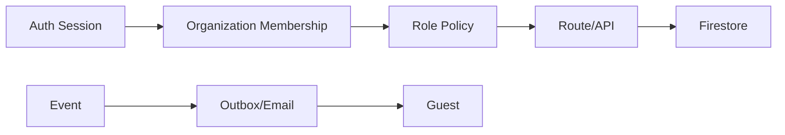

# System Map

## Repository/package architecture

## Domain flows

Deployment topology is configuration-defined for Vercel frontend targets, Render/backend targets, and Firebase/Firestore dependencies; no deployment was performed or validated.
